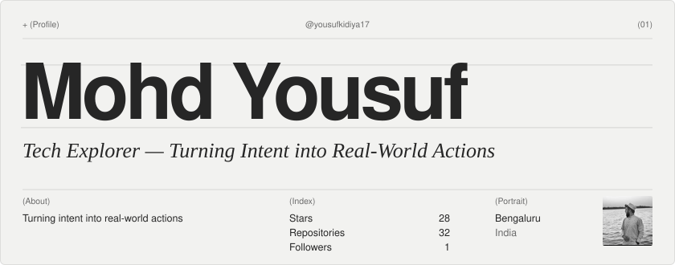

 
 

 
 

  &nbsp;
  &nbsp;
  

 

---

## About Me

**Tech Explorer || Turning Intent into Real-World Actions**

Pursuing **B.TECH from RKDF University, Bhopal (MP)**.

- **6+ years** hands-on experience in the commodity & FMCG distribution ecosystem, operations, supply chain dynamics, and ground-level execution
- **3+ years** exposure to financial markets, risk management, data-driven decision-making, analytical thinking
- Learning AI, Artificial General Intelligence and Data scientific algorithm
- Building a platform that **bridges the gap between user intent and real-world execution**, moving tasks from conversation to completion through a unified interface

 

## Projects

<table>
<tr>
<td width="50%"></td>
<td width="50%"></td>
</tr>
<tr>
<td width="50%"></td>
<td width="50%"></td>
</tr>
<tr>
<td width="50%"></td>
<td width="50%"></td>
</tr>
<tr>
<td width="50%"></td>
<td width="50%"></td>
</tr>
</table>

 

## 🛠 Tech I Work With

 

## 📣 Let's Connect

Profile built by 🤍