

<picture><source media="(prefers-color-scheme: dark)" srcset="./yousuf-header-v2-dark.svg"/>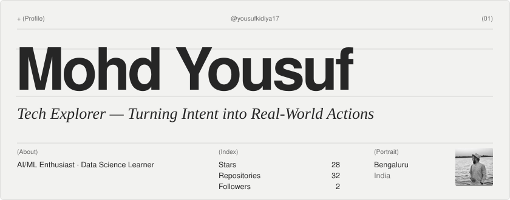</picture>

 
 

<picture><source media="(prefers-color-scheme: dark)" srcset="./about-card-dark.svg"/>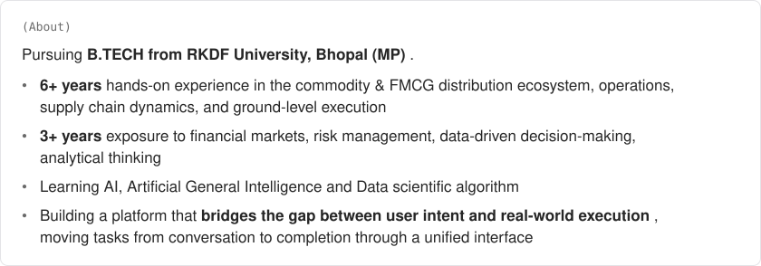</picture>

 
 

  <a href="https://www.linkedin.com/in/mohd-yousuf-a9648b2b0/"><picture><source media="(prefers-color-scheme: dark)" srcset="./social-linkedin-dark.svg"/></picture></a>&nbsp;
  <a href="mailto:kidiyayousuf17@gmail.com"><picture><source media="(prefers-color-scheme: dark)" srcset="./social-email-dark.svg"/></picture></a>&nbsp;
  <a href="https://www.instagram.com/mohd_yousuf.17/"><picture><source media="(prefers-color-scheme: dark)" srcset="./social-instagram-dark.svg"/></picture></a>

 
 

<picture><source media="(prefers-color-scheme: dark)" srcset="./contrib-heatmap-dark.svg"/></picture>

 

---

## Projects

<table>
<tr>
<td width="50%"><a href="https://github.com/yousufkidiya17/tally-mcp"><picture><source media="(prefers-color-scheme: dark)" srcset="./repo-tally-mcp-dark.svg"/>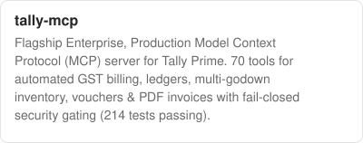</picture></a></td>
<td width="50%"><a href="https://github.com/yousufkidiya17/aiml-journey"><picture><source media="(prefers-color-scheme: dark)" srcset="./repo-aiml-journey-dark.svg"/>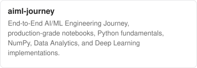</picture></a></td>
</tr>
<tr>
<td width="50%"><a href="https://github.com/yousufkidiya17/aetherix-ai"><picture><source media="(prefers-color-scheme: dark)" srcset="./repo-aetherix-ai-dark.svg"/>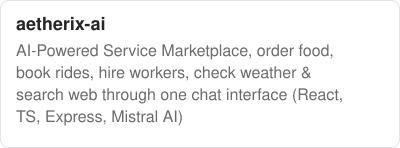</picture></a></td>
<td width="50%"><a href="https://github.com/yousufkidiya17/smart-trading-scanner"><picture><source media="(prefers-color-scheme: dark)" srcset="./repo-smart-trading-scanner-dark.svg"/>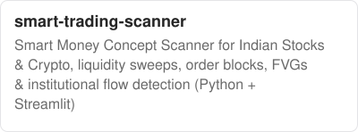</picture></a></td>
</tr>
<tr>
<td width="50%"><a href="https://github.com/yousufkidiya17/OPEN-HERMES"><picture><source media="(prefers-color-scheme: dark)" srcset="./repo-open-hermes-dark.svg"/>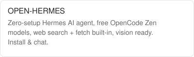</picture></a></td>
<td width="50%"><a href="https://github.com/yousufkidiya17/hermeszen-adk"><picture><source media="(prefers-color-scheme: dark)" srcset="./repo-hermeszen-adk-dark.svg"/>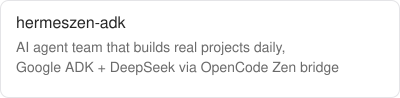</picture></a></td>
</tr>
<tr>
<td width="50%"><a href="https://github.com/yousufkidiya17/train-travel-assistant"><picture><source media="(prefers-color-scheme: dark)" srcset="./repo-train-travel-assistant-dark.svg"/>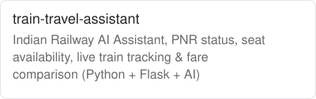</picture></a></td>
<td width="50%"><a href="https://github.com/yousufkidiya17/opencode-local-api"><picture><source media="(prefers-color-scheme: dark)" srcset="./repo-opencode-local-api-dark.svg"/>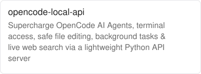</picture></a></td>
</tr>
</table>

 

## 🛠 Tech I Work With

<picture><source media="(prefers-color-scheme: dark)" srcset="./stack-dark.svg"/>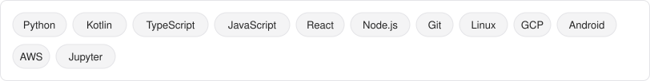</picture>

 

## 📣 Let's Connect

Profile built by 🤍