<h3><code>yousuf@github ~ $ whoami</code></h3>

<table>
<tr>
<td valign="top"></td>
<td valign="top"></td>
</tr>
</table>

 
 

<h3><code>yousuf@github ~ $ ./contributions.sh</code></h3>

 
 

<h3><code>yousuf@github ~ $ ./links.sh</code></h3>

 

---

## About Me

**Tech Explorer || Turning Intent into Real-World Actions**

Pursuing **B.TECH from RKDF University, Bhopal (MP)**.

- **6+ years** hands-on experience in the commodity & FMCG distribution ecosystem, operations, supply chain dynamics, and ground-level execution
- **3+ years** exposure to financial markets, risk management, data-driven decision-making, analytical thinking
- Learning AI, Artificial General Intelligence and Data scientific algorithm
- Building a platform that **bridges the gap between user intent and real-world execution**, moving tasks from conversation to completion through a unified interface

 

## Projects

| Project | What it is |
|---|---|
| **[tally-mcp](https://github.com/yousufkidiya17/tally-mcp)** | Flagship Enterprise, Production Model Context Protocol (MCP) server for Tally Prime. 70 tools for automated GST billing, ledgers, multi-godown inventory, vouchers & PDF invoices with fail-closed security gating (214 tests passing). |
| **[aiml-journey](https://github.com/yousufkidiya17/aiml-journey)** | End-to-End AI/ML Engineering Journey, production-grade notebooks, Python fundamentals, NumPy, Data Analytics, and Deep Learning implementations. |
| **[aetherix-ai](https://github.com/yousufkidiya17/aetherix-ai)** | AI-Powered Service Marketplace, order food, book rides, hire workers, check weather & search web through one chat interface (React, TS, Express, Mistral AI) |
| **[smart-trading-scanner](https://github.com/yousufkidiya17/smart-trading-scanner)** | Smart Money Concept Scanner for Indian Stocks & Crypto, liquidity sweeps, order blocks, FVGs & institutional flow detection (Python + Streamlit) |
| [OPEN-HERMES](https://github.com/yousufkidiya17/OPEN-HERMES) | Zero-setup Hermes AI agent, free OpenCode Zen models, web search + fetch built-in, vision ready. Install & chat. |
| [hermeszen-adk](https://github.com/yousufkidiya17/hermeszen-adk) | AI agent team that builds real projects daily, Google ADK + DeepSeek via OpenCode Zen bridge |
| [train-travel-assistant](https://github.com/yousufkidiya17/train-travel-assistant) | Indian Railway AI Assistant, PNR status, seat availability, live train tracking & fare comparison (Python + Flask + AI) |
| [opencode-local-api](https://github.com/yousufkidiya17/opencode-local-api) | Supercharge OpenCode AI Agents, terminal access, safe file editing, background tasks & live web search via a lightweight Python API server |

 

## 🛠 Tech I Work With

           

 

## 📣 Let's Connect

**⭐ Star [HermesZen](https://github.com/yousufkidiya17/hermeszen-ai) — free AI, zero setup, sab ke liye!**

Profile built with ❤️ + Hermes